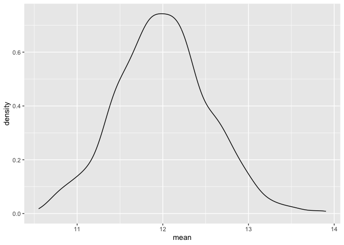
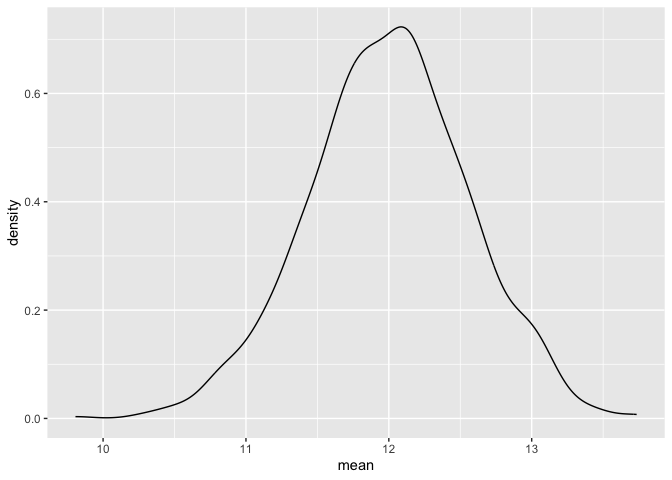
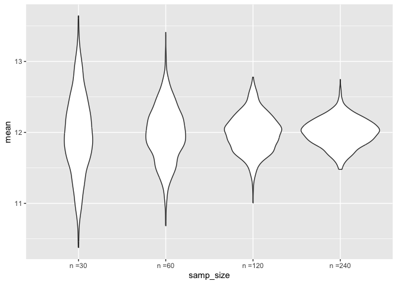

03_simulation
================
2026-11-10

``` r
library(tidyverse)
```

    ## ── Attaching core tidyverse packages ──────────────────────── tidyverse 2.0.0 ──
    ## ✔ dplyr     1.2.1     ✔ readr     2.2.0
    ## ✔ forcats   1.0.1     ✔ stringr   1.6.0
    ## ✔ ggplot2   4.0.3     ✔ tibble    3.3.1
    ## ✔ lubridate 1.9.5     ✔ tidyr     1.3.2
    ## ✔ purrr     1.2.2     
    ## ── Conflicts ────────────────────────────────────────── tidyverse_conflicts() ──
    ## ✖ dplyr::filter() masks stats::filter()
    ## ✖ dplyr::lag()    masks stats::lag()
    ## ℹ Use the conflicted package (<http://conflicted.r-lib.org/>) to force all conflicts to become errors

``` r
source("source/sim_mean_sd.R")
```

## Mean and SD

Can We Check CLT Using Simulations?

``` r
sim_mean_sd(n_obs = 30)
```

    ## # A tibble: 1 × 2
    ##    mean    sd
    ##   <dbl> <dbl>
    ## 1  11.7  3.11

Let’s Do This, But Keep Track of Results

``` r
output = vector("list", length = 1000)

for (i in 1:1000) {
  
  output[[i]] = sim_mean_sd(n_obs = 30)
  
}
```

Inspect Results

``` r
output |>
  bind_rows() |>
  summarize(
    emp_m = mean(mean),
    emp_se = sd(mean)
  )
```

    ## # A tibble: 1 × 2
    ##   emp_m emp_se
    ##   <dbl>  <dbl>
    ## 1  12.0  0.545

``` r
output |>
  bind_rows() |>
  ggplot(aes(x = mean)) +
  geom_density()           # check updated sim_mean_sd.R source
```

<!-- -->

Let’s Do This Using Tibbles and Map Instead

``` r
sim_results_df =
  tibble(
    samp_size = rep(30, 1000)
  ) |>
  mutate(                                  # considered the intermediate dataframe
    est_df = map(samp_size, sim_mean_sd)
  ) |>
  unnest(est_df)
```

Look at the Results

``` r
sim_results_df |>
  ggplot(aes(x = mean)) +
  geom_density()
```

<!-- -->

## Change `n`

``` r
sim_results_df =
  expand_grid(
    samp_size = c(30, 60, 120, 240),     # gives all combinations of the listed numbers 1,000 times
    iter = 1:1000
  ) |>
  mutate(                                  # considered the intermediate data frame
    est_df = map(samp_size, sim_mean_sd)
  ) |>
  unnest(est_df)
```

``` r
sim_results_df |>
  mutate(
    samp_size = str_c("n =", samp_size),
    samp_size = fct_inorder(samp_size)
  ) |>
  ggplot(aes(x = samp_size, y = mean)) +
  geom_violin()
```

<!-- -->

Look at the Numbers

``` r
sim_results_df |>
  mutate(
    samp_size = str_c("n =", samp_size),
    samp_size = fct_inorder(samp_size)
  ) |>
  group_by(samp_size) |>
  summarize(
    emp_m = mean(mean),
    emp_se = sd(mean)
  )
```

    ## # A tibble: 4 × 3
    ##   samp_size emp_m emp_se
    ##   <fct>     <dbl>  <dbl>
    ## 1 n =30      12.0  0.553
    ## 2 n =60      12.0  0.386
    ## 3 n =120     12.0  0.266
    ## 4 n =240     12.0  0.196
